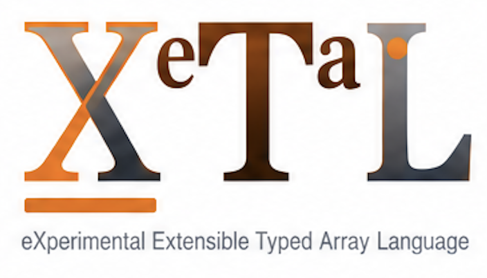

<h1>
  
  
</h1>

<p align="center">
  <b><a href="https://softwarewrighter.github.io/X_eTaL-ML/">The live ML demos</a></b>
  -- every demo running in your browser (WebAssembly)<br>
  <b><a href="https://softwarewrighter.github.io/X_eTaL-ML/recorded/">Run them yourself</a></b>
  -- every demo at the command line, from a clone<br>
  <b><a href="https://softwarewrighter.github.io/X_eTaL-ML/doc/">Read the code</a></b>
  -- the cross-reference of every demo program and library (`xetal doc`)
</p>

Machine learning in [X_eTaL](https://github.com/softwarewrighter/X_eTaL),
the eXperimental Extensible Typed Array Language: small models you can
watch think, and the ML libraries they are made of.

## Why an array language for ML

Most of what an ML framework hides behind layers and modules is array
algebra. A dense layer is one inner product and an addition. Softmax
is an exponential, a row sum and a division. Attention is two matrix
products and a softmax. A mixture-of-experts router is a matrix
product and a top-k. Quantizing a network to ternary weights is a
rounding of one array.

In X_eTaL each of those is one short, typed expression over whole
arrays, so a demo can show the model itself: the weights, every
intermediate array with its shape, and the moment where a loop nest
you would write elsewhere turns out to be a single array
transformation.

Every demo here follows one arc:

> a small X_eTaL program -> a visible model -> the array
> transformations stepped through -> something about ML revealed.

## How X_eTaL differs from APL

X_eTaL keeps APL's whole-array thinking but is designed with ideas
from Haskell and Rust: ASCII source rendered as mathematical
typography, inferred static types (Haskell-style inference, so the
terse code needs no annotations, and pieces that cannot compose are
rejected before they run), and explicit, checked interfaces in the
Rust spirit. For ML that means a shape or type mistake in a layer is
an error before the forward pass, not a wrong number after it.

"Extensible" has three meanings, and this repo uses them in turn:

- **Libraries extend the vocabulary.** ML building blocks (softmax,
  dense layers, quantization, convolution, attention) are ordinary
  `.xtl` libraries here, imported with `u_se<`, typed and tested.
- **Macros extend the language.** The [Net](libs/Net/docs/README.md) macro
  library lets a network be written as
  `"784 128 relu 10 softmax" net:n_etwork< "w1 w2"`, which expands into
  ordinary, visible, type-checked code (`xetal expand` shows it).
- **Native extensions extend the machine.** Fast kernels and data
  loaders can come from Rust through typed facades
  ([X_eTaL-extensions](https://github.com/softwarewrighter/X_eTaL-extensions)).

## The X_eTaL repositories

| Repo | What it is |
| ---- | ---------- |
| [X_eTaL](https://github.com/softwarewrighter/X_eTaL) | the language, interpreter, REPL, editor, notebook and browser playground |
| [X_eTaL-demos](https://github.com/softwarewrighter/X_eTaL-demos) | visual array and scientific computing demos |
| **X_eTaL-ML** (this repo) | machine-learning demos and libraries |
| [X_eTaL-games](https://github.com/softwarewrighter/X_eTaL-games) | interactive games and puzzles |
| [X_eTaL-libraries](https://github.com/softwarewrighter/X_eTaL-libraries) | reusable function and macro libraries |
| [X_eTaL-extensions](https://github.com/softwarewrighter/X_eTaL-extensions) | native Rust extensions and the extension ABI |

## Demos

All thirteen run live in your browser and at the command line.
[Start with the Tiny CNN](https://softwarewrighter.github.io/X_eTaL-ML/cnn-digits/):
draw a digit and watch a network read it.

| Demo | What you see | The line that does it |
| ---- | ------------ | --------------------- |
| [Tiny CNN](demos/cnn-digits/README.md) ([live](https://softwarewrighter.github.io/X_eTaL-ML/cnn-digits/)) | draw a digit; filters, feature maps, pooling and probabilities, every stage computed by X_eTaL; click a map for its arithmetic | `-1 0 1 o_-_2 -1 0 1 o_-_2 x`: every 3 x 3 window of the picture at once |
| [Backprop microscope](demos/backprop/README.md) ([live](https://softwarewrighter.github.io/X_eTaL-ML/backprop/)) | one training step with every array shown: forward, loss, each layer's gradient, the step; every gradient checked by nudging its weight; take steps and watch the loss fall | `(o_\ u:o_nes X) '+ '* i_nner D1`: a layer's gradient, one matrix product |
| [CNN training](demos/cnn-backprop/README.md) ([live](https://softwarewrighter.github.io/X_eTaL-ML/cnn-backprop/)) | X_eTaL trains a tiny CNN from random weights on 600 handwritten digits in your browser: the backward pass through softmax, dense, max-pooling, ReLU and the convolution, checked by finite differences; the filters form and the test digits come to be read right | `DC := (A cv:u_npool DQ) * f_loat C > 0.0`: back through pooling and ReLU, a whole batch at once |
| [Training live](demos/train-live/README.md) ([live](https://softwarewrighter.github.io/X_eTaL-ML/train-live/)) | X_eTaL trains a small network on a spiral in your browser; the decision regions bend to follow it as the loss falls | `s := 25 'u:a_dam p_ower s`: Adam's step, iterated |
| [Tiny GPT](demos/micro-gpt/README.md) ([live](https://softwarewrighter.github.io/X_eTaL-ML/micro-gpt/)) | Karpathy's microgpt (4,192 weights, trained on baby names) inventing names a letter at a time in your browser; the next-letter probabilities and each head's attention for any name | `x1 := x0 + heads u:l_inear Wo`: four heads over the whole name at once, joined, added back |
| [Tiny BERT](demos/micro-bert/README.md) ([live](https://softwarewrighter.github.io/X_eTaL-ML/micro-bert/)) | the encoder twin of Tiny GPT (7,594 weights, 2 layers, every letter looking both ways) filling a blank letter in a name: the likeliest letters, where each head of each layer looks, and BERT drawn in one line of math beside its attention as Equations reads it | `(hL, _) := L 'u:l_ayer p_ower (u:e_mbed ids, 1)`: one encoder layer, a pipeline, applied L times |
| [Attention microscope](demos/attention/README.md) ([live](https://softwarewrighter.github.io/X_eTaL-ML/attention/)) | one head of attention on your sentence: scores, weights, a causal mask; "tired" finds the animal, "wide" the street | `(Q '+ '* i_nner o_\ K) / 2.0 ^ 0.5`: every query against every key |
| [MoE routing microscope](demos/moe-router/README.md) ([live](https://softwarewrighter.github.io/X_eTaL-ML/moe-router/)) | a sentence's tokens routed to their top-2 of 16 experts; nudge a token and see where the experts switch | `u:t_op2 u:s_oftmax u:s_cores x`: scores, softmax and top-2 for all tokens |
| [Network macro](demos/net-macro/README.md) ([live](https://softwarewrighter.github.io/X_eTaL-ML/net-macro/)) | a network written as one line; the function the macro wrote for it; three networks on a spiral; type a spec of your own and train it in the browser | `"u:d_eep c" net:m_odel< "2 16 relu 16 relu 3 softmax"`: a macro call that becomes the weights' loading and the forward function |
| [Pipelines](demos/pipelines/README.md) ([live](https://softwarewrighter.github.io/X_eTaL-ML/pipelines/)) | layers written as data flow, each beside what the macro wrote and the same layer in plain X_eTaL; a CNN layer and a diffusion sampler four ways each: as a paper prints them (drawn as math; the sampler's sum over the steps as a recurrence), as a pipeline, as its expansion, as plain X_eTaL, all the same values; compose your own from a palette of the notations' parts; pipelines of equations (an attention head, a BERT layer) drawn as math a row a stage | `@ flow:p_ipe< c"z \|> 'm_ax r_/ it $m \|> e_xp z - m $e \|> e / '+ r_/ e"`: a stable softmax as data flow, written out by the macro as ordinary code |
| [Embedding explorer](demos/embedding-explorer/README.md) ([live](https://softwarewrighter.github.io/X_eTaL-ML/embedding-explorer/)) | word embeddings made from counts in X_eTaL, turned in 3-D: animals, foods, colors, numbers and places gather; click a word for its nearest | `E := em:u_nit 64 em:p_roject em:p_pmi (v, 2) em:c_ooccur ids`: a whole embedding table, one line |
| [k-means](demos/k-means/README.md) ([live](https://softwarewrighter.github.io/X_eTaL-ML/k-means/)) | clustering without labels, step by step: five blobs, the centers moving to their points' means; a poor start settles wrong, farthest-first finds all five | `(((o_\ O) '+ '* i_nner X) + C * f_loat n = 0.0) / 1.0 m_ax n`: every center's new place at once |
| [World model](demos/world-model/README.md) ([live](https://softwarewrighter.github.io/X_eTaL-ML/world-model/)) | a network that watched a ball bounce predicts the next frame from the last three; 1,897 of 1,936 exact, 348 of the 387 it never saw; let it dream and it plays the ball forward, bounces included | `act:s_igmoid (act:r_elu X nn:d_ense wb1) nn:d_ense wb2`: every state's next frame at once |
| [Learned denoiser](demos/diffusion/README.md) ([live](https://softwarewrighter.github.io/X_eTaL-ML/diffusion/)) | pictures from noise in ten steps: a convolutional network trained to see the clean picture in a noisy one, run backward; eight at a time, every level shown; the same noise gives the same pictures | `(((t s_elect ra) * C) + (t s_elect rb) * (X - ((1 + t) s_elect ra) * C) / (1 + t) s_elect rb, t - 1)`: one step down for all the pictures |
| [1.58-bit network](demos/ternary-net/README.md) ([live](https://softwarewrighter.github.io/X_eTaL-ML/ternary-net/)) | one classifier with FP32, FP16, INT8 and ternary weights compared; a ternary layer as additions | `(f_loat x > s) - f_loat x < n_eg s`: a layer's weights to -1, 0, +1 |

Every page shows all the code it runs, beside the arrays that code
computed. Programs are short: weights and other data live in each
demo's `data/` directory, not in the source. Every program and library
is in [the cross-reference](https://softwarewrighter.github.io/X_eTaL-ML/doc/)
(`xetal doc`, `just doc`): its `##` documentation and `###` sections,
its source drawn as X_eTaL draws it, every name linked to where it is
defined and used.

### Run them yourself

Rust (stable), git and [`just`](https://github.com/casey/just);
`just xetal` fetches and builds the X_eTaL commit this repository
pins, so nothing else is installed:

```bash
git clone https://github.com/softwarewrighter/X_eTaL-ML
cd X_eTaL-ML
just xetal               # fetch and build the pinned X_eTaL (once, a few minutes)
just tour cnn-digits     # each statement, then its result
just run attention       # just the results
just serve cnn-digits    # its page, at http://127.0.0.1:8435/
```

## Libraries

| Library | Alias | What |
| ------- | ----- | ---- |
| [NN](libs/NN/docs/README.md) | `nn:` | activations, softmax by row (any rank), dense layers, a bias along a named axis (`nn:a_ddAxis`, `nn:b_ias`), argmax, one-hot, loss, accuracy |
| [Activations](libs/Activations/docs/README.md) | `act:` | fifteen activations item by item (ReLU, leaky, PReLU, ELU, SELU, sigmoid, tanh, softplus, SiLU, Swish, GELU in its tanh and exact forms, Mish, hard sigmoid, hard swish), a derivative for each in terms of the input, the gated layers (`(W, V) act:s_wiglu x`: GLU, ReGLU, GEGLU, SwiGLU); a comparison of their shapes, costs and uses on its page |
| [Norm](libs/Norm/docs/README.md) | `nm:` | normalizing each row: standardizing, layer norm (gain and bias), RMS norm |
| [Sample](libs/Sample/docs/README.md) | `sm:` | choosing the next token: greedy, temperature, top-k, a draw by given uniform numbers |
| [Optim](libs/Optim/docs/README.md) | `op:` | optimizers as steps on a tuple: gradient descent and Adam, a weight array and its averages in, moved out |
| [Quant](libs/Quant/docs/README.md) | `qz:` | weights in fewer bits: float rounding (FP32, FP16, bfloat16), symmetric integers, ternary codes and their scale, a ternary layer as additions |
| [Attention](libs/Attention/docs/README.md) | `at:` | attention as three array expressions: scaled dot-product scores, masked softmax weights, causal masks, a head |
| [Conv](libs/Conv/docs/README.md) | `cv:` | convolution for a batch of pictures: 3 x 3 windows, filters as one matrix product, max-pooling, and their backward passes |
| [Embed](libs/Embed/docs/README.md) | `em:` | word embeddings from counts: co-occurrence (counted by sorting), PPMI, a fixed projection, cosine neighbors |
| [Learn](libs/Learn/docs/README.md) | `ml:` | classic machine learning after APLearn's list, each a fit and a predict: k-means (`(k, n) ml:k_means X`), k nearest neighbors, PCA (`(mu, V, ev) := 2 ml:p_ca X`), logistic regression |
| [Net](libs/Net/docs/README.md) | `net:` | a macro library: `"u:n_et w" net:m_odel< "784 128 relu 10 softmax"` becomes the weights' loading, checked, and an ordinary function of NN calls, shown by `xetal expand`; `"u:s_tep X Y lr" net:t_rain< "2 4 tanh 2 softmax"` writes the network's backprop and an Adam step |
| [Flow](libs/Flow/docs/README.md) | `flow:` | a macro library: ML data flow written left to right, `@ flow:p_ipe< c"X |> it nn:d_ense W1 |> act:r_elu |> it nn:d_ense W2 |> nn:s_oftmax"` becomes one line of X_eTaL per stage; `$name` names a stage's value for the later ones (`$(Q, K, V)` a tuple), ` [N O]` is a shape checked when the program runs; a reader that uses all of its text or refuses it; a stage may be an equation (Equations' `e:e_q&lt;`, the names in its strings counted), and `flow:m_ath&lt;` draws a pipeline as math, a row a stage |
| [Integrals](libs/Integrals/docs/README.md) | `integ:` | a macro library: `@ integ:i_ntegral< "integral tau:=0..2 by trapezoid 128 \| (u:b_ox tau) * u:b_ox t - tau"` is a definite integral by a quadrature rule (trapezoid or simpson, the grid named), the body X_eTaL over the grid; `integ:t_ex<` its LaTeX; improper integrals refused; X_eTaL's Saga 42 call, to be lifted into Equations |

The demos import it (`"nn:" u_se< "NN"`), at the command line and in
the browser. [The libraries' site](https://softwarewrighter.github.io/X_eTaL-ML/libs/)
shows each one's reference and runs its demos in the browser, to edit
and run again. From
[X_eTaL-libraries](https://github.com/softwarewrighter/X_eTaL-libraries),
pinned like X_eTaL itself, the tests use Check and the pages draw
training curves with Plot (and Strings, Format and Lists, which it
imports).

## Status

| | Today |
| - | ----- |
| Demos | 13, all live, each with command-line and browser tests; three of them train in X_eTaL, a CNN among them; one clusters (k-means), one explores embeddings, one is a tiny GPT, one a tiny world model that dreams, one a learned denoiser drawing shapes from noise |
| Libraries | NN (14 functions, typed, tested); Integrals (2 macros: exact where each rule should be, orders 4 and 16 shown, the box convolution converging to the triangle, 11 refusals pinned); Net (6 macros, every expansion pinned; written gradients checked against finite differences); Flow (2 macros, pipelines written as code strings: the five pipelines of X_eTaL's oracle equal their hand-written code, 16 differential checks, 16 refusals pinned, the run-time shape check); Learn (10 functions: k-means, kNN, PCA, logistic regression; k-means checked against Rust, all by their properties); Embed (7 functions: counts, PPMI, projection, neighbors); Quant (7 functions: float, integer and ternary formats, additions); Conv (5 functions: windows, convolution, pooling, their gradients); Attention (5 functions: scores, weights, masks, a head); Norm (3) and Sample (4) for the tiny GPT; Optim (3: gradient descent, Adam); every item documented, 83 doc examples run by the gate |
| X_eTaL | pinned at X_eTaL main b8a6ac3b, after v0.1.0: tuples with patterns (the training state is one), `h:` private names, each name bound once (checked here too, `just check-rebind`), hygiene by choice (a macro's own names from `[]G_ENSYM`: Net's are), raw strings, `xetal expand` laid out as a program (`XETAL_COMMIT`, `just xetal-version`); X_eTaL-libraries at ed91e6d (Plot's charts, Equations, every library documented) |
| Speed | measured and guarded (`just bench-check`, [`docs/speed.md`](docs/speed.md)); the CNN's whole program runs in a third of a second |
| Waiting on X_eTaL | a grade per row, arrays in and out of the browser engine, `e_ach` returning arrays, the libm builtins `t_anh` and `e_rf` ([`docs/xetal-asks.md`](docs/xetal-asks.md)); from X_eTaL-libraries, trigonometry, special functions and differentiation in Equations ([`docs/xetal-libraries-asks.md`](docs/xetal-libraries-asks.md)) |
| On GPUs | through [X_eTaL-gpu](https://github.com/softwarewrighter/X_eTaL-gpu) (OpenCL), at the command line: the world model's 1,936-state batch and the benchmarks run on an Apple M1 Max and an RTX 5060 Ti with the same results as X_eTaL (the kernels under a millisecond; the text bridge is the cost), the denoiser, cnn-digits' 1,000-digit batch and micro-gpt's 1,000-name batch next (`demos/*/batch.xtl`); X_eTaL-gpu is moving to lowering the programs from their own `.xtl`, so a model's accelerated part is one function of arrays ([`docs/speed.md`](docs/speed.md), [`docs/gpu-asks.md`](docs/gpu-asks.md)) |
| Later | the batch models on GPUs with X_eTaL-gpu, run from their own source ([`docs/plan.md`](docs/plan.md)) |

## Build

Requirements: Rust (stable), git,
[`just`](https://github.com/casey/just) and
[`uv`](https://docs.astral.sh/uv/). The scripts' Python is a
uv-managed virtual environment, `.venv` (Python 3.12, from
`.python-version`), made by `scripts/py` on first use; the system's
Python is never used. The first `just xetal` needs the network (it
clones X_eTaL).

```bash
just                # list the recipes
just xetal          # fetch and build the pinned X_eTaL (work/xetal, bin/xetal)
just xetal-version  # which commits are pinned, and the binary's own report
just eval "'+ r_/ 1 2 3"
just gate           # the pre-commit gate: what the change touches; just gate --full for everything
```

This repository tracks no copy of X_eTaL: `XETAL_COMMIT` holds the
commit it is known to work with, and `just xetal` clones X_eTaL into
the gitignored `work/xetal/`, checks that commit out, builds it and
links `bin/xetal` to the binary (as X_eTaL's `docs/vendoring.md`
describes). Every recipe runs that binary, so results do not depend
on whatever `xetal` is on your PATH. The libraries used from
X_eTaL-libraries are pinned the same way (`XETAL_LIBRARIES_COMMIT`).
`just xetal-pin [REF]` moves to a newer X_eTaL.

### Layout

- `demos/<slug>/` -- one demo per directory: its `.xtl` programs, a
  README, reg-rs baselines in `reg/`, an offline trainer in `train/`
  when it has learned weights, and its web page in `web/`.
- `site/` -- the libraries' live site (pages/libs/): every library's
  reference, types and demos, run in the browser.
- `libs/<Name>/` -- one library per directory: `src/<Name>.xtl`, its
  reference page `docs/README.md`, `demos/`, and reg-rs `tests/`
  (including `types.rgt`, which pins every export's type).

```bash
just pages                # build the live site into pages/ (not tracked): the libraries in pages/libs, the cross-reference in pages/doc
just doc                  # the cross-reference alone (xetal doc), into pages/doc
just doc-test             # run every ## >> example in the libraries' doc comments
just publish              # put it live: pages/ becomes the gh-pages branch
just serve-pages          # preview it at http://127.0.0.1:8435/X_eTaL-ML/
just demos                # the demos, in catalog order
just run SLUG             # run a demo's program; just show SLUG as a notebook
just tour SLUG            # the notebook paced, long lines clipped (as recorded)
just record [SLUG]        # re-record the CLI-only demos (vhs, ffmpeg, gif2webp)
just libs                 # the libraries and their aliases
export XETAL_PATH="$(just path)"   # use the libraries from your own programs
just test                 # every demo and library baseline
just bench                # time the ML workloads (docs/speed.md)
```

## Development

Development is tracked with agentrail sagas, as in X_eTaL:
`agentrail status` shows the current step, `agentrail next` its
instructions. Every step ends with the gate passing, docs updated, a
commit to `main` and a push. Every commit is listed in
[`CHANGES.md`](CHANGES.md).

## Related Projects

- [sw-mlpl](https://github.com/sw-ml-study/sw-mlpl) -- Software
  Wrighter's Machine Learning Programming Language, a Rust array
  language inspired by APL, APL2, J, and BQN.
- [microgpt-mlpl](https://github.com/softwarewrighter/microgpt-mlpl)
  and [microgpt-rs](https://github.com/softwarewrighter/microgpt-rs)
  -- Karpathy's microgpt in MLPL and in Rust.

## Links

- Blog: [Software Wrighter Lab](https://software-wrighter-lab.github.io/)
- Discord: [Join the community](https://discord.com/invite/Ctzk5uHggZ)
- YouTube: [Software Wrighter](https://www.youtube.com/@SoftwareWrighter)

## Copyright

Copyright (c) 2026 Michael A Wright

## License

MIT. See [`LICENSE`](LICENSE) and [`COPYRIGHT`](COPYRIGHT).
