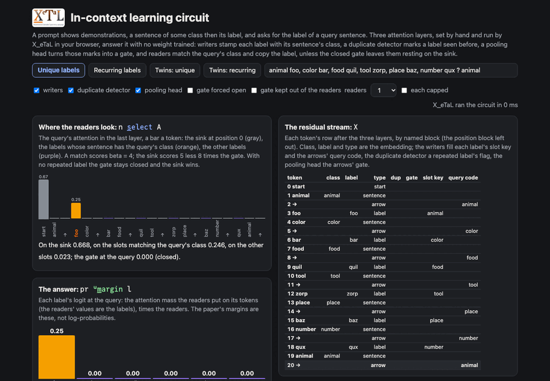

# In-context learning circuit

A prompt shows demonstrations, a sentence of some class and then a
label, and asks for the label of a query sentence. A language model
answers such prompts without changing a weight: it learns in context.
Gao and Gao (arXiv 2611.05344, November 2026) traced how in models of
0.6B to 8B parameters, and built the mechanism by hand in three
attention layers to show it is enough. This demo is that hand-built
circuit in X_eTaL, run in your browser on the prompt you give it, with
each part kept or knocked out.

Live: [In-context learning circuit](https://softwarewrighter.github.io/X_eTaL-ML/icl-circuit/)
(pick a prompt or type one, such as `animal foo, color bar, animal
foo ? animal`; knock out the writers, the duplicate detector or the
pooling head; force the gate open or keep it out of the readers;
give it more readers, each capped).

On [the ML
timeline](https://softwarewrighter.github.io/X_eTaL-ML/ml-timeline/#2026-11),
at November 2026, beside the idea it shows: the paper's hand-built
circuit, its parts knocked out one at a time.

[](https://softwarewrighter.github.io/X_eTaL-ML/icl-circuit/)

## The circuit

Each token's row of the residual stream is 174 numbers in eight named
blocks: class (8), label (16), position (128), token type (4: the
start, a sentence, an arrow, a label), a duplicate flag, the gate, the
slot key (8) and the query code (8). A token's first row holds its
class, label, position and type; the rest is zero until a layer writes
it. Every weight is a block of 0s and 1s read from one block and
written to another (`u:b_lock`), so each head says what it does:

1. **Writers** (layer 1). A label attends to the sentence two tokens
   back (a query that is the position block read two rows lower, at a
   score of 50) and copies its class into its **slot key**: the label
   is now keyed by its class. The arrow does the same one token back
   and writes the **query code**.
2. **Duplicate detector** (layer 1). A label attends to the earlier
   labels, 20 for the same label and 10 for the start token; its flag
   is the weight it puts on labels, near 1 for a repeat and near 0
   otherwise.
3. **Pooling** (layer 2). Each arrow averages the labels' flags into
   its **gate**: half the labels repeat, the gate is 0.5.
4. **Readers** (layer 3). The query's arrow scores each slot by its
   query code against the slot key, beta = 4 for a matching class and
   0 otherwise, and the start token, the **sink**, at 5 less alpha = 8
   times the gate. The values are the labels, so each label's logit is
   the attention on its tokens.

With every label different the gate stays closed: the sink scores 5
against a match's 4 and takes two thirds of the attention, and the
answer's margin is 0.24. One repeated label opens it: the sink falls to
1, the matching slots take 0.84 and the margin is 0.83.

The program builds it all in X_eTaL: `u:a_ttn` is one head (scores,
Attention's masked softmax, the output, each a matrix product),
`u:r_un` is the circuit, `u:r_ead` and `u:m_argin` measure what the
readers did.

## The paper's numbers, reproduced

The command line runs the paper's Section 12 (`just run icl-circuit`):

| Prompt | The circuit | Margin | Paper | Sink | Paper |
| ------ | ----------- | ------ | ----- | ---- | ----- |
| unique | intact | 0.2416 | 0.24 | 0.6683 | 0.67 |
| unique | the gate added (duplicate detector out) | 0.7278 | 0.73 | 0.0007 | emptied |
| recurring | intact | 0.8251 | 0.83 | 0.0209 | 0.02 |
| recurring | duplicate detector knocked out | 0.3889 | 0.39 | 0.5385 | 0.54 |
| recurring | ... and the gate added back | 0.8424 | 0.84 | 0.0004 | |
| recurring | ... but kept out of the readers' queries | 0.3889 | 0.39 | 0.5385 | |
| recurring | writers knocked out | 0.0 | 0.00 | 0.1197 | |

- **The read law** (the paper's Proposition 1): the readers' attention
  on the matching slots is `n_m e^beta / (n_m e^beta + (N - n_m) +
  n_rest + e^(sink - alpha g))`. On sixteen prompts (2 to 6 classes,
  1 to 4 demonstrations each) the softmax and the law differ by less
  than 1e-15, as the paper says: the law is the softmax the readers
  are built from.
- **More readers, each capped** (its Proposition 2): each reader
  copies at a fifth of the strength and the readout is normalized
  against unit noise. The margin is 0.1649, 0.4912, 1.2513 and 2.5262
  with 1, 3, 8 and 20 readers (the paper: 0.16, 0.49, 1.25, 2.53). No
  one reader carries the answer; many small ones do, as in the real
  models.
- The page's tests hold the unique prompt to the authors' committed
  results to 1e-12 (sink 0.6682924705322446, margin
  0.24156734814027003). The recurring prompt agrees to 1e-5. The
  authors average twenty shuffled orders of the demonstrations; this
  demo uses one, and the duplicate detector's leak onto other labels
  depends a little on order.

Two things the paper's text leaves out, read from its code: the
margins are differences of attention mass (the readers' values are the
labels themselves, with no unembedding), not log-probabilities; and
its two prompts are six classes with one demonstration each and three
classes with two each, not the four-demonstration battery the
Section 12 text names.

## What the real models do, and what this is not

In the paper's models the same parts are spread over many heads: about
twenty writers, about ninety readers, sixteen duplicate-token heads
feeding pooling heads, and about two dozen brake heads that work
against the most recent label (the hand-built circuit has none). A
3.4M-parameter model trained from scratch grew writers and readers,
but grew the gate only when retrieval on unique-label prompts was
penalized in training. This demo shows the mechanism is enough; it
does not show a model learns it. That is the next demo's question.

## Run it

```bash
just run icl-circuit          # the paper's two prompts, its knockouts, the read law, more readers
just show icl-circuit         # as a notebook: each statement, then its output
just serve icl-circuit        # the web app at http://127.0.0.1:8435/
just test-demo icl-circuit    # its CLI and browser baselines and the web app's tests
```

## Sources

- Andrew Gao and William Gao, "A Circuit for In-Context Learning",
  arXiv 2611.05344, November 2026, Section 12 and Propositions 1 and 2.
- The circuit's construction and constants (beta 4, sink 5, alpha 8;
  the scores 50, 20 and 30; the 174-wide stream) are reimplemented from
  the authors' `toy/toy_circuit.py`
  (<https://github.com/andrewgcodes/in-context-learning-circuit>, MIT
  license), and checked against its committed `toy/toy_results.json`.

## Workarounds

None.
