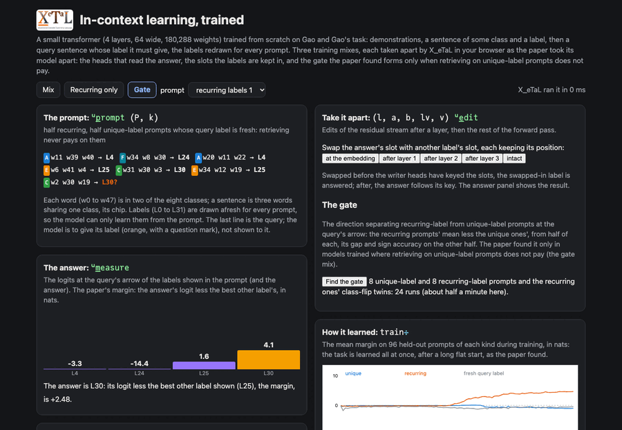

# In-context learning, trained

The [In-context learning circuit](../icl-circuit/README.md) demo
builds Gao and Gao's mechanism by hand (arXiv 2611.05344, November
2026). This demo asks their next question: does a transformer trained
from scratch grow the same parts?

A small transformer is trained on the paper's synthetic task under
the paper's three training mixes. X_eTaL then takes each trained model
apart the way the authors took theirs apart.

Live: [In-context learning, trained](https://softwarewrighter.github.io/X_eTaL-ML/icl-trained/)
(pick a model and a prompt; see which heads answer it; swap a slot;
find the gate and push the model along it).

On [the ML
timeline](https://softwarewrighter.github.io/X_eTaL-ML/ml-timeline/#2026-11),
at November 2026, beside the idea it shows: the same parts grown by a
small transformer trained from scratch, and the gate only when
retrieving does not pay.

[](https://softwarewrighter.github.io/X_eTaL-ML/icl-trained/)

## The task

A prompt is the start token, some demonstrations `w w w -> label`,
then a query `w w w ->`. The model must give the query's label.

- **Words:** there are 48 words, each in two of eight classes.
- **Sentences:** a sentence is three words that share exactly one
  class. That class is the sentence's class.
- **Labels:** there are 32 labels, drawn afresh for every prompt. A
  label means nothing until the prompt pairs it with a class, so the
  model can only learn the mapping from the prompt.
- **Unique-label prompts:** 3 to 6 classes, one demonstration each.
- **Recurring-label prompts:** 2 to 4 classes, 1 to 3 demonstrations
  each, one label per class.
- **Loss:** the model is trained on every label after an arrow.

The three training mixes:

| Mix | What it trains on |
| --- | ----------------- |
| mix | half unique-label prompts, half recurring |
| recurring only | recurring-label prompts only |
| gate | half recurring; half unique-label prompts whose query label is fresh (not among the demonstrations), so that retrieving from a slot never pays on a unique-label prompt |

## The model and its training

`train/` is a std-only Rust trainer that writes the backward pass out
by hand. It is checked against central differences with `--check`.

- **The model:** a Llama-style transformer with 4 layers, 64 wide, 4
  heads of 16, pre-RMSNorm and a SwiGLU feed-forward layer of 128;
  180,288 weights in all.
- **The optimizer is the paper's:** AdamW with learning rate 1e-3,
  betas 0.9 and 0.95, weight decay 0.1; 200 warmup steps, then a
  linear decay to 5%; the gradient clipped to norm 1; 64 prompts a
  step.
- **The data generator** is reimplemented from the authors'
  `toy/train_toy.py`.

Each model learns the task all at once, after a long flat start, as
the paper found. The page draws the curves.

Not every seed learned within its budget:

| Mix | Seed, steps | Learned |
| --- | ----------- | ------- |
| mix | 0, 25k | yes, at about 10k (shipped) |
| recurring only | 0, 25k; 1, 50k | no |
| recurring only | 2, 100k | yes, at about 10k (shipped) |
| gate | 0, 50k | yes, at about 25k, still rising at the end (shipped) |
| gate | 1, 50k | barely (recurring margin 1.9) |
| gate | 2, 100k | no |

The paper also lost one gate seed in five.

`just icl-trained-data` retrains the three shipped runs (about 5
hours) and writes `data/`. The weights there are rounded to 4 places,
and every number in this demo is the rounded model's.

## Taken apart, in X_eTaL

`icl-trained.xtl` reads a model's weights and runs its forward pass:
- RMS norm;
- four heads on Attention's masked softmax;
- SwiGLU from Activations (`act:s_wiglu`).

An edit of the residual stream can be applied after any layer. On the
same prompts the logits match the Rust model's to the 4 places written.
Then the program measures what the authors' `toy/analyze_toy.py`
measures:

- **The margin:** the answer's logit less the best other label shown,
  on unique-label and on recurring-label prompts.
- **The readers:** each head's direct contribution to the margin (its
  write at the arrow, through the last norm and the unembedding). The
  same prompt is then run with its query sentence replaced by one of
  another class shown (a class-flip twin). The readers are the heads
  whose contribution follows the query's class.
- **The slot swap:** the answer's slot and another label's slot are
  exchanged after a layer. Swapped before the writer heads have keyed
  the slots, the swapped-in label is answered. Swapped after, the
  answer follows its key.
- **The gate direction:** at the query's arrow, the recurring prompts'
  mean less the unique ones'.
  - It is fitted on half of each kind.
  - On the other half come its gap and its sign accuracy (chance is
    0.5).
  - Pushing the arrow by one gap along it, at the layer where the gap
    is largest, should close the gate on recurring prompts or open it
    on unique ones. A random direction of the same length is the
    control.

What the command line measured, 8 prompts of each kind (`just run
icl-trained`). The paper's numbers are in brackets.

| Mix | Unique | Recurring | Direction | Recurring toward unique (random) | Unique toward recurring (random) |
| --- | ------ | --------- | --------- | -------------------------------- | -------------------------------- |
| mix | 7.03 [8.8] | 6.39 [8.8] | 0.63 [0.60] | 5.25 (4.97) [8.9 (8.8)] | 6.04 (6.47) [8.7 (8.7)] |
| recurring only | 6.78 [10.3] | 8.46 [10.4] | 0.50 [0.54] | 8.70 (8.60) [10.4 (10.4)] | 6.71 (7.02) [10.2 (10.3)] |
| gate | -0.58 [1.8 to 2.3] | 6.02 [8.7 to 9.1] | 1.00 [0.81 to 1.00] | 4.00 (5.84) [0.7 (7.0), 1.1 (5.8)] | -0.23 (-1.01) [8.0 (1.8), 4.0 (0.9)] |

The slot swap, as the swapped-in label's logit less the answer's:

| Mix | No swap | At the embedding | After layer 1 | After layer 2 | After layer 3 |
| --- | ------- | ---------------- | ------------- | ------------- | ------------- |
| mix | -9.29 | 7.16 | 6.59 | 2.14 | -9.38 |
| recurring only | -10.38 | 1.62 | 1.73 | -9.89 | -10.29 |
| gate | -7.24 | 4.45 | 1.66 | -0.43 | -7.20 |

What this shows, read plainly:

- **The slots are there.** Every model keys its slots in its middle
  layers. A swap before then moves the answer by 12 to 16 nats; the
  paper reports 7 to 11 at the writer layers.
- **The readers are there, most clearly in the mix model.** In the mix
  model the class flip moves two heads of the last layer, 4:4 and 4:3,
  by about 2 each: the paper's "one or two reader heads in the last
  layer".
  - **The other two models:** their readers are weaker and spread out.
    Recurring only: 4:1 and 2:3. Gate: 2:1 and 4:2, about 0.4 each.
- **The gate forms only under the gate mix, as the paper found,** but
  weaker.
  - **Unique-label prompts:** the gate model leaves them unanswered
    (margin -0.58, where the other two give about 7).
  - **The direction:** its direction at the arrow after layer 3 is
    decoded perfectly on held-out prompts (1.00). In the other two
    models it is at chance (0.50 to 0.63).
  - **Steering:** pushing recurring prompts along it toward "unique"
    drops their margin by 2.0. The same push in a random direction
    costs 0.2. The paper's strongest seeds dropped 8 nats.
  - **Not both ways:** pushing unique prompts toward "recurring" does
    not open the gate here. The paper found which side could be
    steered varied by seed.
  - **No gate elsewhere:** in the mix and recurring-only models the
    same push in the real direction moves the margin about as much as
    the random one does: within 0.5 nats, and the wrong way for unique
    prompts pushed toward "recurring".
- **One difference from the paper:** our recurring-only model answers
  unique-label prompts less well than recurring ones (6.78 against
  8.46); the paper's gave both the same margin.

Eight prompts of each kind are few: a sign accuracy is a count out of
8. The page's tests check that the page finds the same gate as the
command line.

## Departures from the paper

- **A smaller model.** The paper trained 3.4M weights: 256 wide, 8
  heads, an MLP of 512. This one has 180,288: 64 wide, 4 heads. A
  32-wide model did not learn the task in 20k steps.
- **Fewer steps.** The paper ran 40k (mix, recurring only) and 80k
  (gate). The shipped runs are 25k, 100k and 50k.
- **Learned position embeddings, not rotary ones,** so the X_eTaL
  forward pass stays a few lines. A row of the residual stream
  therefore carries its position. A slot swap here exchanges the two
  rows' contents and leaves each its own position embedding, which is
  what a row swap does in the paper's rotary model.
- **One word table for every seed.** The authors drew one per seed.
- **8 prompts of each kind, not 100 to 200.** One forward pass takes
  about a quarter of a second in X_eTaL. The matrix product is X_eTaL's
  ask M16 (`docs/xetal-asks.md`); this is the workaround, named there.

## Run it

```bash
just run icl-trained          # the three models taken apart (about 5 minutes)
just show icl-trained         # as a notebook: each statement, then its output
just serve icl-trained        # the web app at http://127.0.0.1:8435/
just test-demo icl-trained    # its CLI and browser baselines and the web app's tests
just icl-trained-data         # retrain the three models (about 5 hours)
```

## Sources

- Andrew Gao and William Gao, "A Circuit for In-Context Learning",
  arXiv 2611.05344, November 2026: Section 12 ("Trained from scratch")
  and the appendix "Trained model: the gate condition", with its table
  of margins, direction accuracy and steering.
- The task, the training mixes, the optimizer and the measures are
  reimplemented from the authors' `toy/train_toy.py` and
  `toy/analyze_toy.py`
  (<https://github.com/andrewgcodes/in-context-learning-circuit>, MIT
  license).

## Workarounds

- M16 (the matrix product's speed): the models are taken apart on 8
  prompts of each kind, and the page's gate search is 24 runs.
