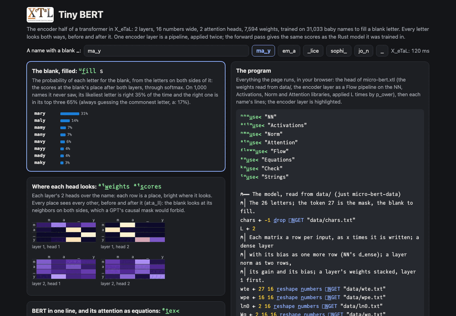

# Tiny BERT

The encoder half of a transformer in X_eTaL (BERT, Devlin et al.
2019): 2 layers, 16 numbers wide, 2 attention heads, 7,594 weights,
trained on 31,033 baby names to fill a blank letter. Every letter
looks at every other, before it and after it, which is what makes it
an encoder. [Tiny GPT](../micro-gpt/README.md) is its twin, a decoder
whose causal mask lets a letter see only those before it. One encoder
layer is a [Flow](../../libs/Flow/docs/README.md) pipeline, applied L
times by `p_ower`, on the [NN](../../libs/NN/docs/README.md),
[Activations](../../libs/Activations/docs/README.md),
[Norm](../../libs/Norm/docs/README.md) and
[Attention](../../libs/Attention/docs/README.md) libraries. The
forward pass gives the same scores as the Rust model it was trained
in, to 1e-9.

Live: [Tiny BERT](https://softwarewrighter.github.io/X_eTaL-ML/micro-bert/)
(type a name with a blank, `ma_y`; see the eight likeliest letters for
it, where each head of each layer looks, and the model drawn as math).

[](https://softwarewrighter.github.io/X_eTaL-ML/micro-bert/)

## Run it

From a clone of this repository (Rust, git, `just` and `uv`):

```bash
just xetal                  # fetch and build the pinned X_eTaL (once)
just run micro-bert         # the model as math, the checks, six blanks filled
just serve micro-bert       # the web app at http://127.0.0.1:8435/
just test-demo micro-bert   # its CLI and browser baselines and the web app's tests
just micro-bert-data        # fetch the names and train again (3 minutes)
```

## BERT in one line

```
BERT(x) = (LN o (I + FFN) o LN o (I + MHA))^L  LN(E_tok[x] + E_pos)
```

The letters' and places' embeddings, layer-normed; then L times: the
multi-head attention (MHA) added back (I +) and layer-normed (LN), the
feed-forward layer (FFN, GELU between two dense layers) added back and
layer-normed. `micro-bert.xtl` writes it four ways and checks that
they agree:

1. **As a paper prints it**, the line above, drawn as LaTeX. Equations
   has no composition or power of functions, so this line is written by
   hand.
2. **As equations**: one head's attention read by X_eTaL-libraries'
   Equations, which computes it and draws it from the same strings:

   ```
   S := "S[i,j] | n n" e:e_q< "(sum k:=0..7 | Q[i,k] * K[j,k]) / sqrt(8.0)"
   A := "A[i,j] | n n" e:e_q< "exp(S[i,j]) / (sum m:=0..n-1 | exp(S[i,m]))"
   Y := "Y[i,d] | n 8" e:e_q< "sum j:=0..n-1 | A[i,j] * V[j,d]"
   ```

   checked equal to head 1 of layer 1. GELU, the layer and its L
   repeats stay outside the strings: an equation's functions are its
   own few (no tanh or erf yet), it cannot call the program's
   functions, and a repeat is not a sum (asks E6, E3 and E2 in
   [docs/xetal-libraries-asks.md](../../docs/xetal-libraries-asks.md)).
3. **As a pipeline**, one encoder layer, applied L times:

   ```
   u:l_ayer := { (H, l) ->
     n := t_ally H
     y := @ flow:p_ipe< c"
        H $h
     |> l u:a_ttention it
     |> (l s_elect ln1) u:n_orm it + h $a [n 16]
     |> act:g_elu it nn:d_ense l s_elect W1
     |> it nn:d_ense l s_elect W2
     |> (l s_elect ln2) u:n_orm it + a $out [n 16]"
     (y, l + 1)
   }
   u:b_ert := { ids ->
     (hL, _) := L 'u:l_ayer p_ower (u:e_mbed ids, 1)
     hL nn:d_ense lm
   }
   ```

   The labels `$h` and `$a` keep the values the residuals add back (a
   pipeline fans out by naming a stage, and in by using the name); `[n
   16]` checks each layer's shape when it runs. The layer number rides
   along with the hidden state so that `p_ower` can pick each layer's
   weights.
4. **As plain X_eTaL**, the same layer written out, checked equal.

The checks: the attention by equations is head 1's; the pipeline
applied L times is the written-out layer; the scores for `em_a` and
where each head looks are the Rust model's within 1e-9.

## Trained offline

`train/` (std-only Rust, a fixed seed; the random numbers and the tape
autograd are micro-gpt's trainer's, with tanh for GELU) trains it as
a masked language model: each name with each of its letters in turn
replaced by the mask token, the loss at the blank; four names a step,
6,000 steps, Adam, about 3 minutes. On 1,000 names it never saw, its
likeliest letter is right for 2,184 of 6,157 blanks (35%) and the right
letter is in its top three for 3,990 (65%); always guessing the
commonest letter, a, is right for 1,035 (17%). The names are
makemore's, fetched into `work/` by `just micro-bert-data`, not
committed.

Left out of BERT, on purpose: the `[CLS]` and `[SEP]` tokens and the
segment embeddings (one name, no sentence pairs), biases in the
attention, BERT's 80/10/10 masking (the blank is always the mask
token), and the next-sentence task.

## What it shows about X_eTaL

- A model as data flow: the encoder layer is one pipeline, its
  residuals two labels, its shapes checked, and `p_ower` stacks it.
- The same arithmetic four ways, the paper's line, equations, a
  pipeline and plain code, checked to agree.
- Attention both ways is the same library call as micro-gpt's with a
  different mask (`at:a_ll` instead of `at:c_ausal`).
