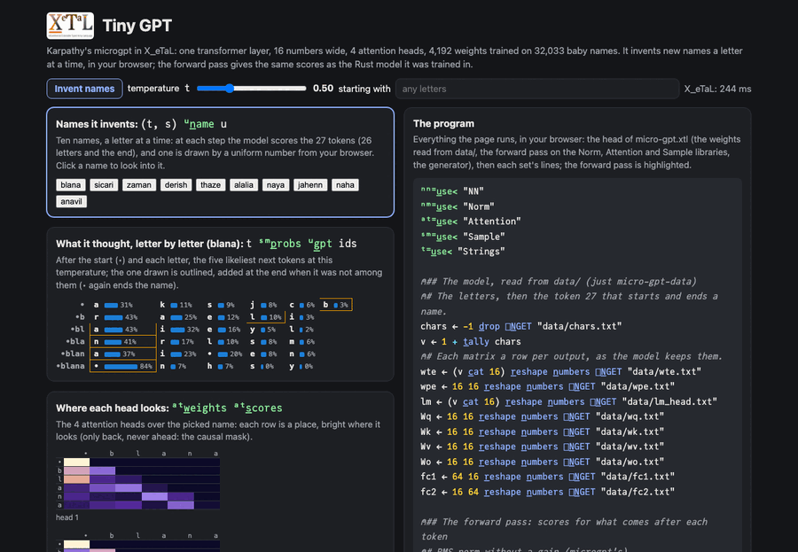

# Tiny GPT

Karpathy's microgpt in X_eTaL: one transformer layer, 16 numbers wide,
4 attention heads, 4,192 weights, trained on 32,033 baby names. It
invents new names a letter at a time. The forward pass reads a whole
name at once under a causal mask, built on the
[Norm](../../libs/Norm/docs/README.md),
[Attention](../../libs/Attention/docs/README.md) and
[Sample](../../libs/Sample/docs/README.md) libraries, and gives the
same scores as the Rust model it was trained in (to 1e-9).

Live: [Tiny GPT](https://softwarewrighter.github.io/X_eTaL-ML/micro-gpt/)
(invent ten names, set the temperature and the first letters; click a
name to see the five likeliest next letters at each step and where
each of the four heads looks).

[](https://softwarewrighter.github.io/X_eTaL-ML/micro-gpt/)

## Run it

From a clone of this repository (Rust, git, `just` and `uv`):

```bash
just xetal                 # fetch and build the pinned X_eTaL (once)
just run micro-gpt         # the check against the Rust model, twenty names, five starting "ma"
just serve micro-gpt       # the web app at http://127.0.0.1:8435/
just test-demo micro-gpt   # its CLI and browser baselines and the web app's tests
just micro-gpt-data        # fetch the names and train again (2 seconds)
just run micro-gpt batch.xtl  # the first 1,000 names scored: the mean loss, the next letters right (about 3.5 s)
```

## The program

`micro-gpt.xtl`. The forward pass, for the tokens of a name so far
(the start token 27, then letters 1 to 26):

```
u:g_pt := { ids ->
  n := t_ally ids
  x0 := u:r_ms (ids s_elect wte) + (r_ange n) s_elect wpe
  hM := (u:r_ms x0, at:c_ausal n)
  heads := (1 u:h_ead hM) c_at_2 (2 u:h_ead hM) c_at_2 (3 u:h_ead hM) c_at_2 4 u:h_ead hM
  x1 := x0 + heads u:l_inear Wo
  x2 := x1 + (0.0 m_ax (u:r_ms x1) u:l_inear fc1) u:l_inear fc2
  x2 u:l_inear lm
}
```

Each token's embedding plus its position's, RMS-normed; four heads of
attention over all positions at once (`at:h_ead`, each taking 4 of the
16 query, key and value directions), joined and projected, added back;
a feed-forward layer of 64 with ReLU, added back; the scores over the
27 tokens. microgpt computes the same one token at a time with a cache
of keys and values; under the causal mask the whole name at once is
the same arithmetic.

Generating, `u:n_ame` repeats a step with `p_ower`: the scores of the
last position at temperature t (`sm:p_robs`), a token drawn by the next
uniform number (`sm:d_raw`), appended; a name ends at token 27. The
uniform numbers come from the caller: `r_oll!` (seeded) at the command
line, the browser's own randomness on the page, so each click
invents new names.

## What it prints

1. `1`: the scores for the start token then "emma", at every
   position, equal the Rust model's (data/expected.txt) to 1e-9.
2. Twenty names at temperature 0.5: alisie kaaha jaria eriza haris
   toria javia kalene aridia apasis anela laria kahlen anadi jajalil
   soren kicen larian kalin chican.
3. Five starting with "ma": maaea maria maryn maris maria.

## The batch: 1,000 names scored

`batch.xtl` scores the first 1,000 names of the training file with
the same forward pass (its head is micro-gpt.xtl's), a name per
call under its causal mask, and sums each name's score: the mean
loss per token over the 7,000 tokens (2.2496, the cross-entropy the
trainer reports) and how many next letters it predicts right
(2,098), both the trainer's Rust model's numbers (the program checks
them: the loss to 1e-9, the count exactly). A name's score:

```
u:s_core := { r ->
  ids := ('+ r_/ r > 0) t_ake r
  S := u:g_pt -1 d_rop ids
  t := 1 d_rop ids
  ('+ r_/ r_avel (v nn:o_neHot t) * n_eg l_og nn:s_oftmax S) c_at (f_loat '+ r_/ (nn:a_rgmax S) = t) c_at f_loat t_ally t
}
```

It is the batch run for a GPU
([`docs/gpu-asks.md`](../../docs/gpu-asks.md)): a thousand calls of
one forward pass, the token ids all that goes in; the decision is
the count of next letters right. About 3.5 s in the evaluator.

## The data

`data/`: the letters and the weights, each matrix a row per output, as
microgpt keeps them, `expected.txt` (the Rust model's scores for
"emma"), and for `batch.xtl` `names.txt` (the first 1,000 names as
rows of 17 token ids: the start token, the letters, the end token,
numbered from 1, then zeros) and `names-loss.txt` (the Rust model's
mean loss per token on them and its count of next letters right).
Written by `train/` (`just micro-gpt-data`), adapted from
[microgpt-rs](https://github.com/softwarewrighter/microgpt-rs) (MIT,
the same author): the same model, training (1,000 steps of Adam, one
name a step) and seed, with a `main` that writes `data/`. The names are
makemore's (Karpathy), fetched into the gitignored `work/`, not
committed.

## Background

Andrej Karpathy's microgpt.py ("the most atomic way to train and run
inference for a GPT", 2025), via its Rust port microgpt-rs and its
array-language port microgpt-mlpl, whose "one masked forward over the
whole document" this follows.
