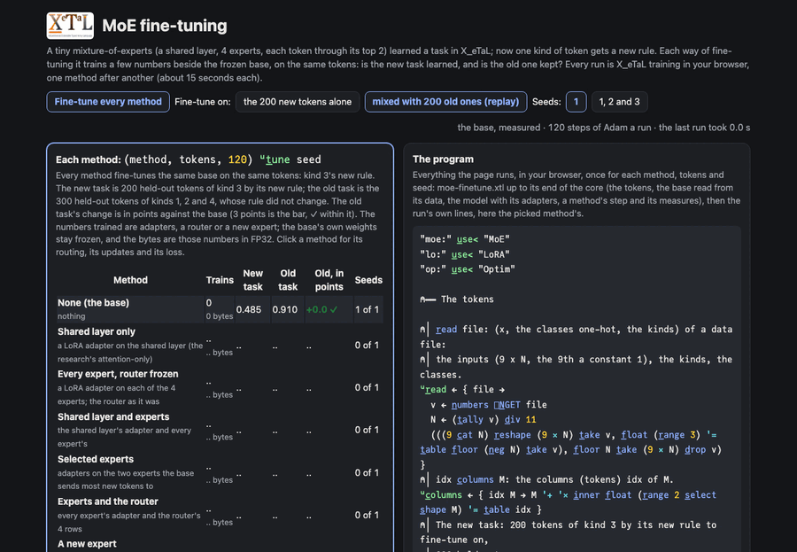

# MoE fine-tuning

A tiny mixture-of-experts model learned a task; now one kind of token
gets a new rule. Each way of fine-tuning it trains a few numbers beside
the frozen base, on the same tokens, and the page asks two questions of
each: is the new task learned, and is the old one kept? The shared
layer, every expert, both, selected experts, the router too, or a new
expert of its own: every run is X_eTaL training in your browser, one
method after another, on the new tokens alone or mixed with old ones,
over one seed or three. Then the research's four adapters compared,
shared LoRA, expert LoRA, LoRA-FA and shared VeRA, at equal ranks and
at equal budgets.

Live: [MoE fine-tuning](https://softwarewrighter.github.io/X_eTaL-ML/moe-finetune/)

[](https://softwarewrighter.github.io/X_eTaL-ML/moe-finetune/)

## The task

Tokens of 8 features, in the moe-router demo's world: each token is
one of 4 kinds (its kind's feature near 0.8, the other three near 0,
with a little noise) and has 4 attributes between -1 and 1. Its class,
1 to 3, is the largest of 3 scores of the attributes, by a rule of its
kind's own: the same attributes mean different classes for different
kinds, which is what experts are for. 800 tokens to train on, 400 held
out (`data/train.txt`, `data/test.txt`: the inputs, the kinds, the
classes).

The new task changes kind 3's rule (its 3 scores from another seed)
and keeps the others: 200 tokens of kind 3 by the new rule to
fine-tune on, 200 held out (`data/shift-train.txt`,
`data/shift-test.txt`). The old task is the 300 held-out tokens of
kinds 1, 2 and 4, whose rule did not change.

## The base model

| Part | Code | Shape | What it is |
| ---- | ---- | ----- | ---------- |
| shared layer | `z := t_anh S '+ '* i_nner x` | 8 x N | every token through one layer (the 9th input a constant 1); S is 8 x 9 |
| router | `G := 2 moe:t_opk moe:s_oftmax R moe:s_cores z` | 4 x N | each token's scores for the 4 experts, as probabilities, its two likeliest kept as the gates; R is 4 x 8 |
| experts | `(ex, G) moe:c_ombine z` | 3 x N | each token through its two experts (3 x 8 each), weighted by the gates |
| classes | `moe:s_oftmax` | 3 x N | each token's probabilities over the 3 classes |

200 numbers, trained in X_eTaL by `train/base.xtl` (`just moe-base`,
half a minute): it makes the tokens (a fixed hash of a sine, no
chance) and trains with Adam (rate 0.02) on the cross-entropy, all 800
tokens at once, for 250 steps. The top 2 cannot be differentiated, so
each token's two experts are held fixed for the step, as training
frameworks do: the router's gradient goes through the two gates (the
MoE library's `moe:g_rads`), the experts' own weights' through their
gates (`moe:g_radsW`), then back through tanh to S. While training,
every expert runs on every token (`moe:d_ense`), the same sum as the
sparse combine and faster at this size. The checkpoint is
`data/base.txt`.

`base.xtl` reads it and gives the baseline:

| | kind 1 | kind 2 | kind 3 | kind 4 | all |
| - | ------ | ------ | ------ | ------ | --- |
| training accuracy | 0.99 | 0.965 | 0.97 | 0.95 | 0.969 |
| held-out accuracy | 0.92 | 0.97 | 0.8 | 0.84 | 0.883 |

and where the held-out tokens go, the router frozen: the share of each
kind's tokens each expert gets (each column sums to 2):

| | kind 1 | kind 2 | kind 3 | kind 4 |
| - | ------ | ------ | ------ | ------ |
| expert 1 | 0.08 | 0.13 | 0.28 | 0.87 |
| expert 2 | 0.89 | 0.03 | 0.79 | 0.31 |
| expert 3 | 0.83 | 0.85 | 0.53 | 0.56 |
| expert 4 | 0.2 | 0.99 | 0.4 | 0.26 |

Each kind has its pair, and expert 3 serves every kind. The routing's
entropy is 0.437 nats (log 4 = 1.386 would be no preference); its
load-balancing loss is 1.056 (1 is even).

## The methods

In the research's order (`docs/fine-tune-moe-research.txt`, L223-294),
then a new expert. Every adapter is LoRA at rank 2 (alpha 4); the
base's own weights stay frozen.

| Method | What trains | Numbers |
| ------ | ----------- | ------- |
| none | nothing: the base | 0 |
| shared layer only | an adapter on the shared layer (the research's attention-only) | 34 |
| every expert, router frozen | an adapter on each of the 4 experts | 96 |
| shared layer and experts | both | 130 |
| selected experts | adapters on the two experts the base sends most new tokens to (2 and 3) | 48 |
| experts and the router | every expert's adapter and the router's 4 rows | 132 |
| a new expert | a fifth expert from 0, and its own router row, starting pointed at the new tokens and away from the old | 36 |

The expert layer's input is z with a constant 1 under it, so a router
row and an expert can have a bias (the base's are 0, so nothing of the
base changes); the fifth expert waits with a router row of bias -30,
never in a token's top 2. A method is a flag per part, `(shared,
experts, router, new)`; one step trains any of them, a frozen part's
gradient multiplied by 0 so Adam leaves it where it is:

```
(R2, m32, v32) := (0.02, t) op:a_dam (R, m3, v3, ((4 r_eshape fR) c_at fN) u:p_er dR)
(As2, m52, v52) := (0.02, t) op:a_dam (As, m5, v5, (fE c_at 0.0) u:p_er dAs)
```

Each runs 120 steps of Adam (rate 0.02) on the new tokens alone, or
mixed with 200 of the old task's training tokens (replay, the usual
guard against forgetting).

## What they do

From the page, three seeds (each adapter's A starts from the seed, B
at 0; the new expert starts from 0 whatever the seed, so its runs
agree). The new task's accuracy, the old task's, and its change
against the base's 0.910, in points; 3 points is the bar the research
sets for regression (L1348):

| Method | New alone: new | old | change | Mixed: new | old | change |
| ------ | --- | --- | ------ | --- | --- | ------ |
| none | 0.485 | 0.910 | 0 | 0.485 | 0.910 | 0 |
| shared layer only | 0.910 | 0.609 | -30.1 | 0.725 | 0.804 | -10.6 |
| every expert, router frozen | 0.788 | 0.648 | -26.2 | 0.750 | 0.849 | -6.1 |
| shared layer and experts | 0.935 | 0.543 | -36.7 | 0.808 | 0.824 | -8.6 |
| selected experts | 0.745 | 0.769 | -14.1 | 0.723 | 0.848 | -6.2 |
| experts and the router | 0.838 | 0.629 | -28.1 | 0.820 | 0.858 | -5.2 |
| a new expert | 0.770 | 0.890 | -2.0 | 0.760 | 0.900 | -1.0 |

- Fine-tuning on the new tokens alone, every method that changes what
  the old kinds pass through forgets them: the shared layer is every
  token's, and the experts kind 3 uses serve the other kinds too
  (expert 3 serves them all). The more a method trains, the better it
  learns the new rule and the more it forgets.
- Replay cuts the damage by half or more, and costs some of the
  new task; still no adapted method keeps the old task within 3 points.
- The router, frozen, still decides which experts learn: with every
  expert's adapter trainable, those the new tokens seldom reach learn
  little, and the routing does not move. The shared layer's adapter
  moves the router's input, so it moves the routing too, as the
  research says (L1734, L2314).
- A new expert, its own router row sending the new tokens to it and
  keeping the old ones away, keeps the old task (it is the only
  method within the bar, even without replay) with the fewest numbers
  but one method; it learns the new task less well than the methods
  that adapt the shared layer. What the research says it takes to get
  an identifiable expert: "controlled routing, expert isolation, or
  training a new expert" (L273).

The page shows, for each method, where the new and the old tokens go
before and after (a bar per expert), each update's size (|s B A|, and
the new expert's weights), and the loss at each step.

## Four adapters compared

The research's comparison (L4307-4430), on the same base and tokens,
the router frozen, as adapters of either kind at any rank:

| Adapter | What trains | Numbers |
| ------- | ----------- | ------- |
| shared LoRA | A and B on the shared layer (the research's attention LoRA) | r (8 + 9) |
| expert LoRA | A and B on each of the 4 experts | 4 r (3 + 9) |
| LoRA-FA | each expert's B, its A frozen from a seed | 4 x 3 r |
| shared VeRA | each expert's d (r numbers) and b (3); one pair of frozen random projections, A0 (r x 9) and B0 (3 x r), for all four | 4 (3 + r) |

VeRA's expert e is LoRA's factors diag(d_e) A0 and diag(b_e) B0, so
the MoE library runs it as any adapter, and the gradients of d and b
follow from the factors' (`u:c_hain`: dA times A0 summed along each
row, dB times B0); a test checks every kind's gradients against
central differences. At rank 2 shared LoRA and expert LoRA are the
methods above, run for run.

At equal ranks (2: 34, 96, 24 and 20 numbers) and at about equal
budgets (shared LoRA at rank 3, 51 numbers; expert LoRA at 1, LoRA-FA
at 4, VeRA at 9, 48 each), on the new tokens alone, seed 1, 120 steps;
the new task's gain over the base's 0.485 and the old task's change
from 0.910, in points, and the gain a number trained (the research's
efficiency):

| Rate | Adapter | Equal ranks: gain | old | gain a number | Equal budgets: gain | old | gain a number |
| ---- | ------- | ---- | --- | ------------- | ---- | --- | ------------- |
| 0.02 | shared LoRA | +45.0 | -31.3 | 1.32 | +44.5 | -34.0 | 0.87 |
| 0.02 | expert LoRA | +30.5 | -27.0 | 0.32 | +29.5 | -26.7 | 0.61 |
| 0.02 | LoRA-FA | -1.5 | -3.3 | -0.06 | +1.5 | -1.3 | 0.03 |
| 0.02 | shared VeRA | -4.0 | -2.3 | -0.20 | +5.5 | -26.7 | 0.11 |
| 0.1 | shared LoRA | +44.0 | -45.0 | 1.29 | +46.0 | -51.7 | 0.90 |
| 0.1 | expert LoRA | +38.5 | -49.3 | 0.40 | +37.0 | -42.0 | 0.77 |
| 0.1 | LoRA-FA | -4.5 | -13.3 | -0.19 | +2.0 | -14.7 | 0.04 |
| 0.1 | shared VeRA | -1.5 | -20.0 | -0.08 | +21.5 | -39.7 | 0.45 |

- An adapter whose projections are frozen moves slowly: at the
  methods' rate, 0.02, LoRA-FA and VeRA barely leave the base in 120
  steps (they keep the old task because they do not learn the new
  one). VeRA's paper trains at several times LoRA's rate, so the page
  offers 0.1 too: there VeRA at rank 9 gains 21.5 points with 48
  numbers.
- On these tiny experts (3 outputs, 9 inputs) a frozen random A
  leaves few useful directions: LoRA-FA at rank 4 still gains little;
  VeRA needs a large rank (9, all of the input's) to learn much.
- Gain a number favors shared LoRA, which also forgets most: the
  research's warning that efficiency never replaces the gain, or the
  old task, holds here. No adapter on the experts keeps the old task
  while learning the new: the experts kind 3 uses serve the other
  kinds too. The new expert above remains the one that does.

## The program

`moe-finetune.xtl`: the tokens, the base with room for a new expert,
the model with its adapters, a method's step and its measures, the
four adapters, up to `# -- end of the core`; then every method on both
choices of tokens at seed 1, and the four adapters at both rates (the
CLI baseline). The page runs the core, then one run's own
lines, for each method, tokens and seed:

```
(m, losses) := (added, mixed, 120) u:t_une 1
(a, o, n, b, sn, so, sz) := m u:r_eport added
```

and for a comparison's run, here shared VeRA at rank 9 at the rate 0.1:

```
(m, losses, n) := (4, 9, (x, Y), 120, 0.1) u:c_ompare 1
```

## Run it

```bash
just run moe-finetune             # every method and the four adapters, seed 1 (three minutes)
just run moe-finetune base.xtl    # the base's baseline
just moe-base                     # make the tokens and train the base again (half a minute)
just serve moe-finetune           # the page, locally
just test-demo moe-finetune       # its baselines, the page's tests, the retraining
```

## Workarounds

None.
